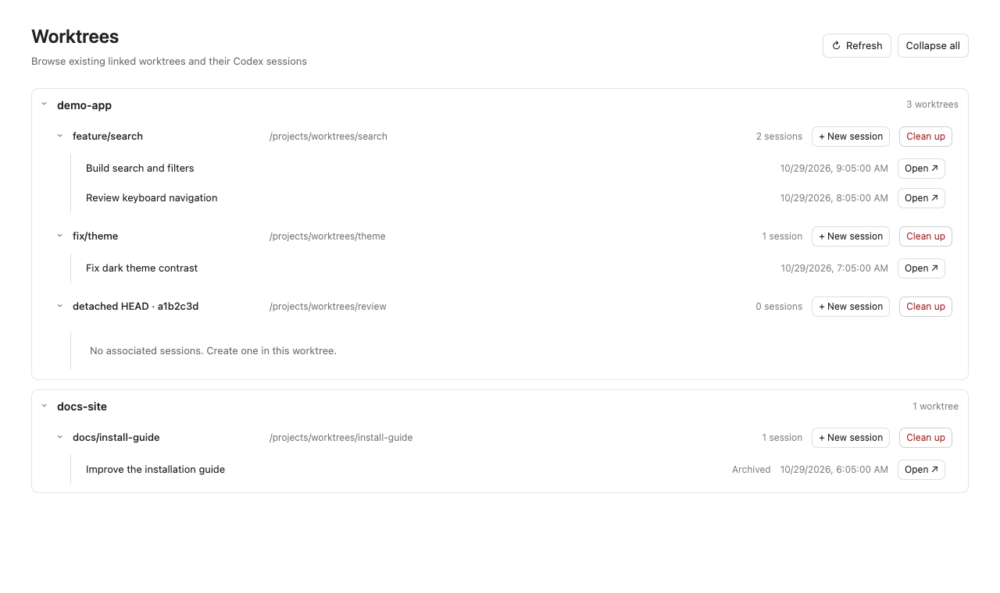

# Codex Worktree Navigator

[English](README.md) | [简体中文](README.zh-CN.md)

Browse **Repository → Worktree → Sessions** in a dedicated Worktrees page inside Codex Desktop. Open existing sessions or create a session in a linked worktree while retaining its original project.

An independent community project, not affiliated with or endorsed by OpenAI. The interface and documentation support English and Simplified Chinese.



*Real extension UI rendered with fictional demonstration data. No private projects or sessions are shown.*

## Requirements

- macOS, Git on PATH, and Node.js 22 or later (including npm) for building and installing.
- Codex Desktop with MCP Apps global entries and an existing local App Server control socket. The recorded validation environment is Desktop 26.1023.51421 / build 22530, App Server 0.165.0. Other host versions need verification.
- The default app location is `/Applications/ChatGPT.app`. Use `--app` if your app has a different name or location.
- A saved Codex project with at least one existing linked Git worktree. The main checkout itself is excluded.

There are no third-party npm dependencies. This integration uses version-dependent host interfaces and is experimental.

## Install

Clone this repository using its **Code → Clone** URL, or download and extract its source archive. Then open a terminal in the project directory:

```bash
node --version
git --version
npm test
npm run check
npm run install:codex
```

No `npm install` step is required. The installer builds and copies a standalone extension to `~/.codex/extensions/worktree-navigator/`, then uses the bundled `codex mcp add` command to register `worktree_navigator`. It backs up an existing `config.toml` under `~/.codex/extensions/backups/` before changing the registration.

**Restart Codex Desktop**, open **Explore**, select **Worktrees**, and pin it to the navigation bar. Codex manages the stdio MCP process; no terminal needs to remain open.

Custom app, configuration directory, or runtime:

```bash
npm run install:codex -- --app /Applications/Codex.app --codex-home /absolute/codex-home
npm run install:codex -- --node /absolute/path/to/node
node scripts/install.mjs --help
```

The installer defaults to the host's bundled Node runtime. `--node` must point to an executable Node.js 22+ runtime. `--codex-home` takes precedence over `CODEX_HOME`, then defaults to `~/.codex`. Use the same options when upgrading or uninstalling.

## Language

The page follows the interface locale supplied by Codex, including host locale updates. It defaults to English when Codex supplies no locale or an unsupported language. Chinese locale variants use Simplified Chinese. There is no page language selector or saved language override; OS and browser language settings do not control the page. Open drafts are preserved when Codex changes the locale.

Buttons, tooltips, accessibility labels, empty states, timestamps, and extension-owned errors follow the Codex locale. Repository names, session titles, user messages, and diagnostic details returned by Git, the OS, or Codex remain in their original language. The host’s own menus and composer follow Codex settings; static plugin discovery text is bilingual.

Installer messages follow `LC_ALL`, then `LC_MESSAGES`, then `LANG`, with English as the fallback. For example, `LC_ALL=zh_CN.UTF-8 npm run install:codex` selects Chinese. Page language is sent with each MCP tool request, independently of the server’s environment.

## Use

- Expand repositories and worktrees; expansion state is saved locally.
- Select **打开 ↗** to open an existing session. Session row text does not navigate.
- Select **新建会话** to choose the original project and optionally enter a first message. Blank input creates an empty session; supplied text is queued for execution after Desktop opens it.
- New sessions start with read-only permissions. Adjust them in Codex as needed. The original repository must already be trusted in Codex.
- Refresh manually, on focus, or automatically every 60 seconds while visible. Deleted and prunable worktrees are excluded; worktrees with no sessions remain visible.
- **Clean up** opens a confirmation dialog for one worktree. Stop tasks using the directory first. Cleanup preserves branches and Codex session records, and refuses main checkouts, locked worktrees, local changes, untracked/ignored files, and sessions loaded in the connected App Server. Detached commits must be retained by a local branch. Other Codex processes may have sessions outside this server’s visibility; close them before confirming. Cleanup uses `git worktree remove` without force. After an error or timeout, refresh to check the result before trying again.
- Detached HEAD entries show a short commit ID. Source branches are not inferred from matching commits.

## Upgrade and uninstall

Update the source checkout and rerun `npm run install:codex`, then restart Codex. The installed copy is independent of the source tree.

```bash
npm run uninstall:codex
# For a custom app or home:
npm run uninstall:codex -- --app /Applications/Codex.app --codex-home /absolute/codex-home
```

Uninstall removes the registration and installed copy, retaining projects, sessions, worktrees, and configuration backups. Restart Codex afterward. Before manually restoring a backup, compare it with the current configuration to preserve later changes by other tools.

## Troubleshooting

| Symptom | What to check |
| --- | --- |
| Installer cannot find an executable | Verify `--app`, or supply `--node`; the bundled CLI is required. |
| Worktrees entry is missing | Restart Desktop, check Explore and the MCP registration. Host support varies by version. |
| App Server connection fails | Check that your existing local App Server is running and uses the same Codex home. The default socket is `$CODEX_HOME/app-server-control/app-server-control.sock`; this extension does not start a server. |
| No worktrees appear | Save the repository as a Codex project, then check `git worktree list` and refresh. Only valid extra worktrees appear. |
| Creation is unavailable | Open the main checkout as a Codex project and confirm trust through Codex. |
| Creation partially fails | Check the reported session ID in native and archived sessions before creating another one. |

The chat composer below the page is controlled by the host. Duplicate-creation protection lasts for the MCP process lifetime; after a restart, inspect existing sessions before retrying an interrupted creation.

## Privacy and architecture

The extension reads saved project roots, Git status, session navigation metadata (including title/preview), and trust settings through local files and the existing App Server. It does not read credential files or send telemetry. Entering a first message queues it in Codex; Codex then handles it using the user's configured model and services.

Discovery uses fixed read-only Git queries. Confirmed cleanup runs a fixed local `git worktree remove` command from the MCP process, without a shell. It uses the current user’s filesystem permissions and can delete the selected directory and its Git registration. Session creation persists the session and permissions, archives/unarchives it to release the creating connection, and optionally queues the message. It never grants directory trust. See [SECURITY.md](SECURITY.md) for reporting guidance.

## Development

```bash
npm test
npm run check
```

Tests use local Git repositories and simulated host protocols. The actual bundled-CLI install test runs when the supported macOS app is available, and otherwise reports a skip. CI runs on Linux and macOS with Node.js 22 and 24. Native Desktop UI acceptance is a separate manual check.

- `src/model.js`, `src/host.js`: discovery, grouping, and session ownership.
- `src/server/`: local App Server transport, Git queries, session creation, and MCP service.
- `src/native-client.js`, `src/index.js`, `src/view.js`: host handshake, page lifecycle, and interface.
- `scripts/`: build, installation, and source/release checks.

See [CONTRIBUTING.md](CONTRIBUTING.md) for validation and release requirements. Distribution files are allowlisted; local `.agents/` evidence and configuration files are excluded. npm publication is disabled with `private: true`; installation is from source.

## License

[MIT](LICENSE).
