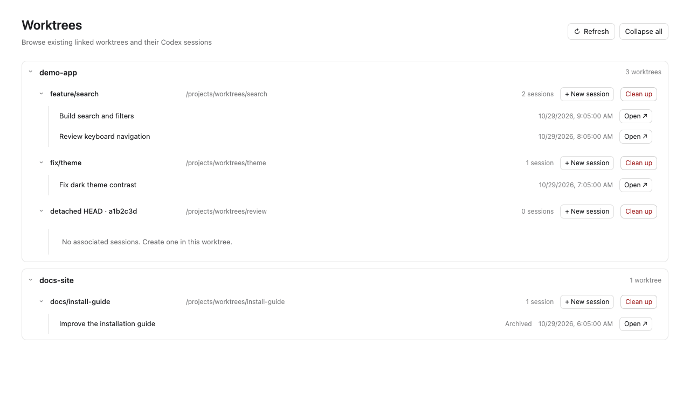

# Codex Worktree Navigator

[English](README.md) | [简体中文](README.zh-CN.md)

Browse **Repository → Worktree → Sessions** in a dedicated Worktrees page inside Codex Desktop, and open saved sessions.

An independent community project, not affiliated with or endorsed by OpenAI. The interface and documentation support English and Simplified Chinese.



*Real extension UI rendered with fictional demonstration data. No private projects or sessions are shown.*

## Requirements

- macOS, Git, sqlite3 and lsof on PATH, and Node.js 22 or later (including npm) for building and installing.
- Codex Desktop with MCP Apps entries and a bundled server supporting `project/list` and `thread/list`. List endpoints were verified with Desktop 26.1103.31037 / build 25241 and bundled server 0.167.0-alpha.3.2.
- The default app location is `/Applications/ChatGPT.app`. Use `--app` if your app has a different name or location.
- A saved Codex project with at least one existing linked Git worktree. The main checkout itself is excluded.

There are no third-party npm dependencies. This integration uses version-dependent host interfaces and is experimental.

## Install

Clone this repository using its **Code → Clone** URL, or download and extract its source archive. Then open a terminal in the project directory:

```bash
node --version
git --version
npm test
npm run check
npm run install:codex
```

No `npm install` step is required. The installer builds and copies a standalone extension to `~/.codex/extensions/worktree-navigator/`, then uses the bundled `codex mcp add` command to register `worktree_navigator`. It backs up an existing `config.toml` under `~/.codex/extensions/backups/` before changing the registration.

**Restart Codex Desktop**, open **Explore**, select **Worktrees**, and pin it to the navigation bar. Codex manages the stdio MCP process; no terminal needs to remain open.

Custom app, configuration directory, or runtime:

```bash
npm run install:codex -- --app /Applications/Codex.app --codex-home /absolute/codex-home
npm run install:codex -- --node /absolute/path/to/node
node scripts/install.mjs --help
```

The installer uses the bundled Node runtime; `--node` can select Node.js 22+. It records the bundled CLI path for list queries. `--codex-home` takes precedence over `CODEX_HOME`, then defaults to `~/.codex`. Use the same options when upgrading or uninstalling.

## Language

The page follows the interface locale supplied by Codex, including host locale updates. It defaults to English when Codex supplies no locale or an unsupported language. Chinese locale variants use Simplified Chinese. There is no page language selector or saved language override; OS and browser language settings do not control the page. Open drafts are preserved when Codex changes the locale.

Buttons, tooltips, accessibility labels, empty states, timestamps, and extension-owned errors follow the Codex locale. Repository names, session titles, user messages, and diagnostic details returned by Git, the OS, or Codex remain in their original language. The host’s own menus and composer follow Codex settings; static plugin discovery text is bilingual.

Installer messages follow `LC_ALL`, then `LC_MESSAGES`, then `LANG`, with English as the fallback. For example, `LC_ALL=zh_CN.UTF-8 npm run install:codex` selects Chinese. Page language is sent with each MCP tool request, independently of the server’s environment.

## Use

- Expand repositories and worktrees; expansion state is saved locally.
- Select **Open ↗** to open an existing session. Session row text does not navigate.
- **+ New session** creates and opens a read-only session in the selected worktree under its original project. An optional first message is queued; the extension does not start model execution. Existing directory trust is required.
- Refresh manually, on focus, or automatically every 60 seconds while visible. Deleted and prunable worktrees are excluded; worktrees with no sessions remain visible.
- **Clean up** removes a confirmed extra worktree while retaining branches and session records. Stop its tasks and archive its sessions first. Unarchived sessions (including empty and attached threads), open files, local changes (including untracked and ignored files), locks, and detached commits without a retaining branch prevent removal.
- Detached HEAD entries show a short commit ID. Source branches are not inferred from matching commits.

## Upgrade and uninstall

Update the source checkout and rerun `npm run install:codex`, then restart Codex. The installed copy is independent of the source tree.

```bash
npm run uninstall:codex
# For a custom app or home:
npm run uninstall:codex -- --app /Applications/Codex.app --codex-home /absolute/codex-home
```

Uninstall removes the registration and installed copy, retaining projects, sessions, worktrees, and configuration backups. Restart Codex afterward. Before manually restoring a backup, compare it with the current configuration to preserve later changes by other tools.

## Troubleshooting

| Symptom | What to check |
| --- | --- |
| Installer cannot find an executable | Verify `--app`, or supply `--node`; the bundled CLI is required. |
| Worktrees entry is missing | Restart Desktop, check Explore and the MCP registration. Host support varies by version. |
| Lists fail to load | Reinstall and reload the MCP connection. Check that `CODEX_CLI_PATH` points to the current bundled CLI. |
| No worktrees appear | Save the repository as a Codex project, then check `git worktree list` and refresh. Only valid extra worktrees appear. |

The global Worktrees page loads without a chat context. The chat composer is controlled by the host.

## Privacy and architecture

Short-lived bundled app-server connections query projects and create persistent sessions. Read-only sqlite3 queries read navigation fields from `state_5.sqlite`, including empty sessions. Unsupported index versions fail explicitly. Fixed Git queries validate directories and lsof checks local process use. The extension does not read credential files or collect telemetry; the bundled server uses the existing Codex configuration.

Browsing and creation have separate RPC allowlists. New sessions are released before navigation to Desktop. Cleanup does not rely on the independent server’s loaded list and is not an atomic lock across applications: stop tasks using the directory and avoid starting new ones during cleanup. See [SECURITY.md](SECURITY.md).
