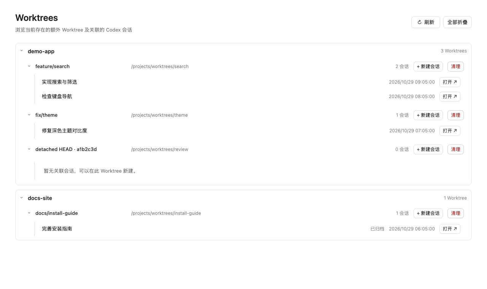

# Codex Worktree Navigator

[English](README.md) | [简体中文](README.zh-CN.md)

在 Codex Desktop 独立的 **Worktrees** 页面中，按 **Repository → Worktree → Sessions** 浏览工作树和已保存会话，并打开已有会话。

本项目是独立社区项目，与 OpenAI 无隶属或背书关系。界面与文档均支持英文和简体中文。



*真实扩展界面，使用完全虚构的演示数据，不包含私有项目或会话信息。*

## 环境要求

- macOS、PATH 中可用的 Git、sqlite3 和 lsof，以及 Node.js 22+（含 npm），用于构建和安装。
- 支持 MCP Apps 入口的 Codex Desktop，内置 server 需支持 `project/list` 和 `thread/list`。已验证 Desktop 26.1103.31037 / build 25241 内置 server 0.167.0-alpha.3.2 的列表接口。
- 默认应用路径为 `/Applications/ChatGPT.app`；名称或位置不同时使用 `--app` 指定。
- Codex 中已保存的项目，以及至少一个真实存在的额外 Git Worktree；主工作目录本身不展示。

项目没有第三方 npm 依赖。集成使用与宿主版本相关的接口，属于实验性扩展。

## 安装

通过仓库页面的 **Code → Clone** 地址克隆，或下载并解压源码。进入项目目录后执行：

```bash
node --version
git --version
npm test
npm run check
npm run install:codex
```

无需执行 `npm install`。安装程序构建并复制独立副本到 `~/.codex/extensions/worktree-navigator/`，再通过应用内置的 `codex mcp add` 注册 `worktree_navigator`。修改前将已有 `config.toml` 备份到 `~/.codex/extensions/backups/`。

**重启 Codex Desktop**，在 **探索 / Explore** 中打开 **Worktrees**，固定到导航栏。stdio MCP 进程由 Codex 管理，无需保持终端运行。

自定义应用、配置目录或 Node 运行时：

```bash
npm run install:codex -- --app /Applications/Codex.app --codex-home /absolute/codex-home
npm run install:codex -- --node /absolute/path/to/node
node scripts/install.mjs --help
```

默认使用应用内置 Node；也可通过 `--node` 指定 Node.js 22+。安装程序保存内置 CLI 路径用于列表查询。配置目录优先级为 `--codex-home`、`CODEX_HOME`、`~/.codex`。升级和卸载时使用相同参数。

## 语言

页面跟随 Codex 提供的界面语言配置，并响应宿主语言更新。Codex 未提供语言信息或语言不受支持时默认英文；中文地区变体统一使用简体中文。页面不提供语言切换菜单，也不保存语言覆盖设置；系统和浏览器语言不影响页面。Codex 语言变化时保留已打开的输入草稿。

按钮、悬浮提示、无障碍标签、空状态、日期格式与扩展自身错误提示均跟随 Codex 语言。仓库名称、会话标题、用户消息，以及 Git、操作系统或 Codex 返回的原始诊断保持原文。宿主自身菜单和聊天框跟随 Codex 设置；静态插件发现文案采用中英文并列。

安装脚本按 `LC_ALL`、`LC_MESSAGES`、`LANG` 的优先级选择语言，默认英文。例如 `LC_ALL=zh_CN.UTF-8 npm run install:codex` 使用中文。页面通过每次 MCP 工具请求传递语言，不依赖服务端的系统语言。

## 使用

- 仓库与 Worktree 可独立折叠，展开状态保存在本地。
- 使用右侧 **打开 ↗** 进入已有会话；点击行文字不跳转。
- **新建会话**：选择原项目，在当前 Worktree 下创建只读会话并打开。可填写首条消息，消息只入队，扩展不自动启动模型执行。目录需已有信任配置。
- 支持手动刷新、获得焦点刷新，以及页面可见时每 60 秒刷新。删除或 prunable 的目录不展示；零会话 Worktree 仍保留。
- **清理**：确认后删除额外 Worktree 目录，保留分支和会话记录。请先停止相关任务并归档该目录下的会话。存在未归档会话（含空会话和附属会话）、本机进程占用、文件变更（含未跟踪及忽略文件）、锁定或未被分支保留的 detached 提交时拒绝清理。
- detached HEAD 显示短 SHA；来源分支不根据相同 Commit 推测。

## 升级与卸载

更新源码后重新执行 `npm run install:codex`，然后重启 Codex。安装副本独立于源码目录。

```bash
npm run uninstall:codex
# 自定义应用或配置目录：
npm run uninstall:codex -- --app /Applications/Codex.app --codex-home /absolute/codex-home
```

卸载移除注册及安装副本，保留项目、会话、Worktree 和配置备份，重启后生效。人工恢复备份前应与当前配置比较，保留其他工具在安装之后新增的配置。

## 排障

| 问题 | 检查方式 |
| --- | --- |
| 安装找不到可执行文件 | 检查 `--app`，或指定 `--node`；仍需要应用内置 CLI。 |
| 没有 Worktrees 入口 | 重启 Desktop，检查探索页和 MCP 注册；宿主支持情况与版本有关。 |
| 列表加载失败 | 重新安装并重新加载扩展 MCP 连接；检查注册配置的 `CODEX_CLI_PATH` 指向当前应用内置 CLI。 |
| 没有 Worktree | 将仓库保存为 Codex 项目，检查 `git worktree list` 并刷新；仅展示有效额外目录。 |

全局 Worktrees 页面无需聊天上下文即可加载列表。页面底部聊天框由宿主管理。

## 隐私与实现边界

扩展通过短生命周期的内置 app-server 查询项目、创建和持久化会话；通过 sqlite3 只读查询 `state_5.sqlite` 中的会话导航字段，包含空会话。仅支持已验证的索引版本，其他版本明确报错。固定 Git 查询核验目录，lsof 检查本机进程占用。扩展不读取凭证文件、不发送遥测；内置 server 使用现有 Codex 配置。

浏览与创建使用独立 RPC 白名单。创建完成后释放该连接的会话再跳转 Desktop。清理不依赖独立 server 的 loaded 列表，也不代表跨进程原子锁；确认前需停止使用目录的任务，避免清理期间启动新任务。安全问题报告方式见 [SECURITY.md](SECURITY.md)。

## 开发与验证

```bash
npm test
npm run check
```

测试使用本地 Git 仓库及模拟宿主协议。真实内置 CLI 安装测试在支持的 macOS 应用存在时执行，其他环境明确跳过。CI 覆盖 Linux、macOS 和 Node.js 22、24；原生 Desktop 界面仍需独立手动验收。

- `src/model.js`、`src/host.js`：发现、分组与会话归属。
- `src/server/`：本地 App Server 通信、Git 查询、新建会话与 MCP 服务。
- `src/native-client.js`、`src/index.js`、`src/view.js`：宿主握手、页面生命周期与界面。
- `scripts/`：构建、安装和源码/发布检查。

贡献和发布要求见 [CONTRIBUTING.md](CONTRIBUTING.md)。分发文件使用白名单，本地 `.agents/` 证据与配置文件不进入分发包。保留 `private: true` 防止误发布 npm，当前采用源码安装。

## 开源协议

[MIT](LICENSE)。
