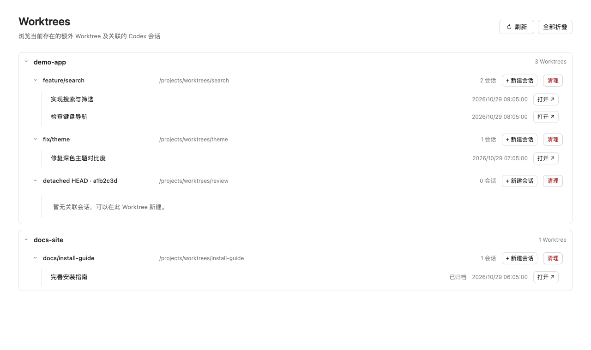

# Codex Worktree Navigator

[English](README.md) | [简体中文](README.zh-CN.md)

在 Codex Desktop 独立的 **Worktrees** 页面中，按 **Repository → Worktree → Sessions** 浏览，打开已有会话，或保留原项目身份在额外 Worktree 中新建会话。

本项目是独立社区项目，与 OpenAI 无隶属或背书关系。界面与文档均支持英文和简体中文。



*真实扩展界面，使用完全虚构的演示数据，不包含私有项目或会话信息。*

## 环境要求

- macOS、PATH 中可用的 Git，以及 Node.js 22+（含 npm），用于构建和安装。
- 支持 MCP Apps 全局入口的 Codex Desktop，以及已运行的本地 App Server control socket。已有验证环境为 Desktop 26.1023.51421 / build 22530、App Server 0.165.0；其他宿主版本需要验证。
- 默认应用路径为 `/Applications/ChatGPT.app`；名称或位置不同时使用 `--app` 指定。
- Codex 中已保存的项目，以及至少一个真实存在的额外 Git Worktree；主工作目录本身不展示。

项目没有第三方 npm 依赖。集成使用与宿主版本相关的接口，属于实验性扩展。

## 安装

通过仓库页面的 **Code → Clone** 地址克隆，或下载并解压源码。进入项目目录后执行：

```bash
node --version
git --version
npm test
npm run check
npm run install:codex
```

无需执行 `npm install`。安装程序构建并复制独立副本到 `~/.codex/extensions/worktree-navigator/`，再通过应用内置的 `codex mcp add` 注册 `worktree_navigator`。修改前将已有 `config.toml` 备份到 `~/.codex/extensions/backups/`。

**重启 Codex Desktop**，在 **探索 / Explore** 中打开 **Worktrees**，固定到导航栏。stdio MCP 进程由 Codex 管理，无需保持终端运行。

自定义应用、配置目录或 Node 运行时：

```bash
npm run install:codex -- --app /Applications/Codex.app --codex-home /absolute/codex-home
npm run install:codex -- --node /absolute/path/to/node
node scripts/install.mjs --help
```

默认使用应用内置 Node；`--node` 应指向可执行的 Node.js 22+。配置目录优先级为 `--codex-home`、`CODEX_HOME`、`~/.codex`。升级和卸载时使用相同参数。

## 语言

页面跟随 Codex 提供的界面语言配置，并响应宿主语言更新。Codex 未提供语言信息或语言不受支持时默认英文；中文地区变体统一使用简体中文。页面不提供语言切换菜单，也不保存语言覆盖设置；系统和浏览器语言不影响页面。Codex 语言变化时保留已打开的输入草稿。

按钮、悬浮提示、无障碍标签、空状态、日期格式与扩展自身错误提示均跟随 Codex 语言。仓库名称、会话标题、用户消息，以及 Git、操作系统或 Codex 返回的原始诊断保持原文。宿主自身菜单和聊天框跟随 Codex 设置；静态插件发现文案采用中英文并列。

安装脚本按 `LC_ALL`、`LC_MESSAGES`、`LANG` 的优先级选择语言，默认英文。例如 `LC_ALL=zh_CN.UTF-8 npm run install:codex` 使用中文。页面通过每次 MCP 工具请求传递语言，不依赖服务端的系统语言。

## 使用

- 仓库与 Worktree 可独立折叠，展开状态保存在本地。
- 使用右侧 **打开 ↗** 进入已有会话；点击行文字不跳转。
- **新建会话** 可选择原项目并填写首条消息。留空或纯空白创建空会话；填写内容则在 Desktop 打开后自动执行首轮。
- 新会话以只读权限开始，可在 Codex 中调整。原仓库需已有 Codex 信任状态。
- 支持手动刷新、获得焦点刷新，以及页面可见时每 60 秒刷新。删除或 prunable 的目录不展示；零会话 Worktree 仍保留。
- **清理** 会对单个工作树弹出确认框，请先停止使用此目录的任务。清理保留分支和 Codex 会话记录，拒绝主工作目录、锁定目录、本地修改、未跟踪/忽略文件，以及连接的 App Server 中仍有已加载会话的目录。detached 提交需先由本地分支保留。其他 Codex 进程的会话可能不在此服务的可见范围内，请在确认前关闭。清理执行不带强制选项的 `git worktree remove`；报错或超时后先刷新确认结果，再决定是否重试。
- detached HEAD 显示短 SHA；来源分支不根据相同 Commit 推测。

## 升级与卸载

更新源码后重新执行 `npm run install:codex`，然后重启 Codex。安装副本独立于源码目录。

```bash
npm run uninstall:codex
# 自定义应用或配置目录：
npm run uninstall:codex -- --app /Applications/Codex.app --codex-home /absolute/codex-home
```

卸载移除注册及安装副本，保留项目、会话、Worktree 和配置备份，重启后生效。人工恢复备份前应与当前配置比较，保留其他工具在安装之后新增的配置。

## 排障

| 问题 | 检查方式 |
| --- | --- |
| 安装找不到可执行文件 | 检查 `--app`，或指定 `--node`；仍需要应用内置 CLI。 |
| 没有 Worktrees 入口 | 重启 Desktop，检查探索页和 MCP 注册；宿主支持情况与版本有关。 |
| App Server 连接失败 | 检查现有本地 App Server 是否运行、是否使用相同 Codex home。默认 socket 为 `$CODEX_HOME/app-server-control/app-server-control.sock`，扩展不会启动服务。 |
| 没有 Worktree | 将仓库保存为 Codex 项目，检查 `git worktree list` 并刷新；仅展示有效额外目录。 |
| 无法新建 | 将主工作目录作为 Codex 项目打开，通过 Codex 确认目录信任。 |
| 创建部分失败 | 根据错误中的会话 ID 检查原生和归档列表，再决定是否重新创建。 |

页面底部聊天框由宿主管理。新建防重记录在 MCP 进程存活期间有效；重启后重试中断的操作前，应检查已有会话。

## 隐私与实现边界

扩展通过本地文件及现有 App Server 读取已保存的项目根目录、Git 状态、会话导航信息（含标题/预览）和信任配置，不读取凭证文件，不发送遥测。填写的首条消息会进入 Codex 队列，随后由 Codex 使用用户配置的模型与服务处理。

目录发现使用固定的 Git 只读查询。确认清理后由 MCP 进程直接执行固定的 `git worktree remove` 命令，不经过 Shell；使用当前用户的文件系统权限删除目标目录及其 Git 登记。新建会话会保存会话与权限，通过归档/恢复释放创建端占用，并按需排队首条消息。扩展不会授予目录信任。安全问题报告方式见 [SECURITY.md](SECURITY.md)。

## 开发与验证

```bash
npm test
npm run check
```

测试使用本地 Git 仓库及模拟宿主协议。真实内置 CLI 安装测试在支持的 macOS 应用存在时执行，其他环境明确跳过。CI 覆盖 Linux、macOS 和 Node.js 22、24；原生 Desktop 界面仍需独立手动验收。

- `src/model.js`、`src/host.js`：发现、分组与会话归属。
- `src/server/`：本地 App Server 通信、Git 查询、新建会话与 MCP 服务。
- `src/native-client.js`、`src/index.js`、`src/view.js`：宿主握手、页面生命周期与界面。
- `scripts/`：构建、安装和源码/发布检查。

贡献和发布要求见 [CONTRIBUTING.md](CONTRIBUTING.md)。分发文件使用白名单，本地 `.agents/` 证据与配置文件不进入分发包。保留 `private: true` 防止误发布 npm，当前采用源码安装。

## 开源协议

[MIT](LICENSE)。
